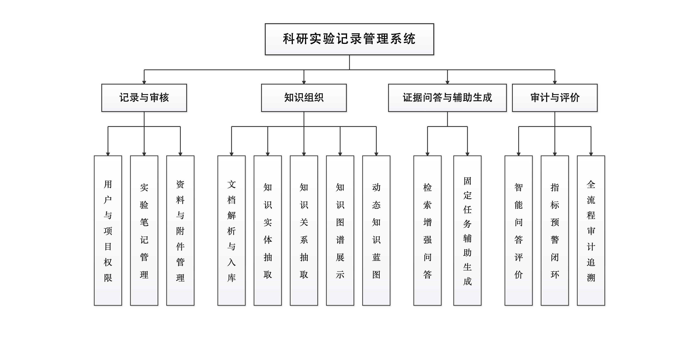

> status: historical
> owner: Codex

# 图 4-2 系统功能模块图重绘记录（T-108，2026-09-30）

## 本轮目标

按用户提供的树形图示例重绘功能模块图，解决旧图中页面入口、业务模块和数据存储混画在同一层的问题。本轮交付独立图件，不覆盖论文 Word 或 Markdown 稿。

## 新图

- 矢量源文件：[fig-4-2-functional-modules.svg](figures-redrawn-2026-09-30/fig-4-2-functional-modules.svg)
- 高分辨率预览：[fig-4-2-functional-modules.png](figures-redrawn-2026-09-30/fig-4-2-functional-modules.png)，2334 × 1573 px

## 结构与内容核对

- 顶层为“科研实验记录管理系统”。
- 界面入口层按前端实际页面列出项目列表、笔记、审批、资料、图谱、AI 问答、报告、预警、设置、系统管理和独立盲评，并明确注明页面入口不计作业务模块。
- 功能模块层按四个功能域分组，保留正文表 4-2 的全部 13 个模块，并在各模块框内补充简短职责说明。
- 数据层按正文定义的四个核心域和一个运行时扩展域呈现，明确其不是物理数据表清单，并标注 PostgreSQL 与 pgvector 持久化。
- 页面至模块、模块至数据层用方向箭头表达请求与读写/检索关系。

内容对照依据为[论文重构稿 4.3 节及表 4-2](毕业论文重构稿.md)；界面名称对照 `frontend/src/app/(dashboard)/projects/[id]/layout.tsx` 及对应路由页面。

## 验收边界

SVG 已按最终尺寸渲染为 PNG 并进行视觉检查，未见文字越框或遮挡。尚未将图件插入 T-107 或其他 Word 文件，也未重排图号、题注和正文引用；后续集成时需要结合目标 Word 版心再确认实际打印字号。
